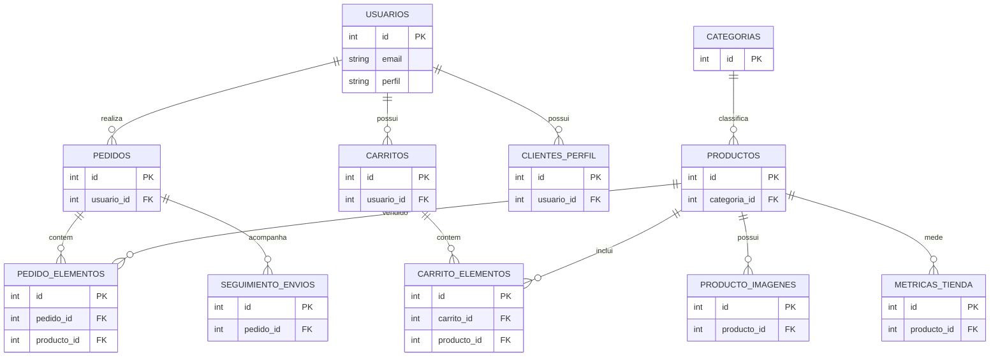

# 🚀 API REST E-Commerce - Documentación Técnica

Backend robusto desarrollado en **Node.js con Express** y persistencia de datos en **PostgreSQL**, equipado con encriptación de contraseñas de seguridad (`bcryptjs`) y validación de sesiones mediante tokens **JWT (JSON Web Tokens)**.

---

## Variables de entorno

En desarrollo local, crea `backend/.env` con los datos de tu instalación local de PostgreSQL. En Render, configura los valores equivalentes en el apartado **Environment** del servicio backend. No subas `.env` al repositorio ni publiques contraseñas reales.

Usa Node.js 22 o una versión compatible con el modo `--watch` usado durante el desarrollo.

Ejemplo local (reemplaza los valores con los de tu entorno):
```text
PORT=3001
DB_USER=postgres
DB_PASSWORD=su_contraseña
DB_HOST=localhost
DB_PORT=5432
DB_NAME=ecommerce
JWT_SECRET=una_frase_secreta_local
FRONTEND_URL=http://localhost:5173
CORS_ORIGINS=https://jagq68.github.io
```

El backend activa SSL cuando `DB_HOST` apunta a un servidor remoto. Render puede proporcionar `PORT`; localmente se usa `3001` si no se define.
En producción, el origen permitido por defecto es `https://jagq68.github.io`. Para autorizar otro frontend, configura `CORS_ORIGINS` con orígenes exactos separados por comas. No se permiten coincidencias por prefijo.

## Persistencia de métricas y estados de pedido

Las ventas del dashboard se calculan desde la tabla persistente `pedidos`, sumando los pedidos con `estado_pago = 'Pago Aprovado'`; no dependen de que el usuario siga conectado. El estado del pago y el estado logístico son campos diferentes: al completar una entrega, el simulador cambia `pedidos.status_envio` a `Entregado` y conserva `pedidos.estado_pago` como aprobado.

En versiones anteriores, el simulador pudo guardar `Entregue` en `estado_pago`, haciendo que esos pedidos dejaran de entrar en las métricas de ventas aunque siguieran en PostgreSQL. La migración idempotente `migrations/add-product-brand.js`, ejecutada al arrancar, convierte solo esas filas a pago aprobado y envío entregado. No borra pedidos, importes ni detalles; se aplica tanto en local como en Render.

## Ejecución local

Desde la carpeta `backend/`:

```bash
npm install
npm run dev
```

El arranque importa `migrations/add-product-brand.js` y completa la migración antes de iniciar Express en `http://localhost:3001`. La migración usa las variables de entorno activas en ese proceso. El frontend se inicia por separado desde `frontend/` con `npm run dev` y normalmente queda en `http://localhost:5173/`.

## Inicialización y migraciones de PostgreSQL

`migrations/add-product-brand.js` es la migración segura para una base ya creada. Agrega `productos.marca` y `productos.descripcion` si faltan, conserva los datos y asigna las marcas conocidas a productos semilla cuyo nombre coincide. El alta de imágenes sigue usando la tabla `producto_imagenes` existente.

También se puede ejecutar manualmente, desde `backend/`:

```bash
npm run migrate:product-brand
```

El comando modifica la base indicada por las variables de ese entorno: ejecutarlo localmente no modifica Render. En Render, el arranque de la aplicación ejecuta la misma migración con las variables configuradas para el servicio. Es idempotente, así que puede ejecutarse de nuevo sin volver a agregar columnas.

**No ejecutes `node init-db.js` sobre una base con información que quieras conservar.** Ese archivo contiene `DROP TABLE ... CASCADE` y reconstruye las tablas. Está destinado exclusivamente a inicializar o reiniciar una base descartable. `seed.js` inserta datos de ejemplo; ejecútalo solo al preparar una base vacía y no como parte de cada despliegue.

## Controles de acceso y límites

El registro público siempre crea perfil `cliente`. Las rutas administrativas exigen un JWT y consultan el rol actual en PostgreSQL. Las operaciones de perfil requieren que el ID de la URL coincida con el ID autenticado. El seguimiento por ID solo permite consultar pedidos propios; el listado global está reservado a administradores.

Login, registro y rastreo público tienen límites de solicitudes por IP con `express-rate-limit`. El almacenamiento de límites es local a cada instancia; si se ejecutan varias instancias detrás de un balanceador, se debe configurar un almacén compartido para que el límite sea global.

---

## 🛣️ Catálogo Completo de Endpoints

### 🔑 1. Autenticación y Usuarios (`/api/auth`)

#### 📝 Registrar un Nuevo Usuario
* **Método:** `POST`
* **URL:** `/api/auth/register`
* **Acceso:** Público
* **Cuerpo JSON Esperado:**
```json
{
  "email": "alberto.prueba@gmail.com",
  "contrasena": "Secreta123",
  "cpf_cnpj": "123.456.789-00",
  "nome_completo": "Alberto Guatume",
  "fecha_nacimiento": "1990-05-15",
  "sexo": "M",
  "telefono": "41999999999",
  "cep": "8324466",
  "direccion": "Rua Principal 123",
  "ciudad": "Curitiba",
  "perfil": "cliente"
}
```
* **Prueba rápida con `curl`:**
```bash
curl -X POST http://localhost:3001/api/auth/register -H "Content-Type: application/json" -d '{"email":"test@gmail.com","contrasena":"123","cpf_cnpj":"000.000.000-11","nome_completo":"Test User"}'
```

#### 🔑 Iniciar Sesión (Generar JWT)
* **Método:** `POST`
* **URL:** `/api/auth/login`
* **Acceso:** Público
* **Cuerpo JSON Esperado:**
```json
{
  "email": "alberto.prueba@gmail.com",
  "contrasena": "Secreta123"
}
```

---

### 📂 2. Categorías (`/api/categorias`)

#### 📋 Listar todas las Categorías
* **Método:** `GET`
* **URL:** `/api/categorias`
* **Acceso:** Público

#### ➕ Crear una Categoría
* **Método:** `POST`
* **URL:** `/api/categorias`
* **Acceso:** **Privado (Requiere Token JWT)**
* **Cabecera Requerida:** `Authorization: Bearer <TOKEN_JWT>`
* **Cuerpo JSON Esperado:**
```json
{
  "nombre": "Nuevos Gadgets"
}
```

---

### 🛍️ 3. Productos (`/api/produtos`)

#### 📋 Listar todos los Productos con Imágenes (`JOIN`)
* **Método:** `GET`
* **URL:** `/api/produtos`
* **Acceso:** Público

#### ➕ Crear un Nuevo Producto con su Colección de Imágenes
* **Método:** `POST`
* **URL:** `/api/produtos`
* **Acceso:** **Privado (Requiere Token JWT)**
* **Cuerpo JSON Esperado:**
```json
{
  "nombre": "TV 50 Pulgadas",
  "marca": "Samsung",
  "descripcion": "Televisor Smart TV de 50 pulgadas",
  "precio": 2800.00,
  "stock": 10,
  "categoriaId": 1,
  "imagenes": [
    "https://link-da-imagem.com",
    "https://link-da-imagem.com"
  ]
}
```

#### Administración de productos
El dashboard permite consultar, agregar y actualizar nombre, marca, descripción, categoría, precio, stock e imagen. Las imágenes se almacenan en `producto_imagenes`. La eliminación se bloquea si el producto está asociado a elementos de carrito o pedido; la API verifica esta condición además del botón del dashboard.

---

### 🛒 4. Carrito de Compras (`/api/carrinhos`)

#### 📋 Obtener el Carrito del Usuario Autenticado
* **Método:** `GET`
* **URL:** `/api/carrinhos`
* **Acceso:** **Privado (Requiere Token JWT)**
* **Ejemplo con `curl`:**
```bash
curl -X GET http://localhost:3001/api/carrinhos -H "Authorization: Bearer <SU_TOKEN_JWT>"
```

#### ➕ Agregar o Incrementar Producto en el Carrito
* **Método:** `POST`
* **URL:** `/api/carrinhos`
* **Acceso:** **Privado (Requiere Token JWT)**
* **Cuerpo JSON Esperado:**
```json
{
  "productoId": 1,
  "cantidad": 2
}
```

#### ❌ Remover un Producto del Carrito
* **Método:** `DELETE`
* **URL:** `/api/carrinhos/:productoId`
* **Acceso:** **Privado (Requiere Token JWT)**

---

## Diagrama Entidade-Relacionamento (DER)

**Estado:** versão provisória para revisão e validação por Alberto.

Este diagrama representa as principais tabelas e relações da base de dados PostgreSQL. As chaves primárias, as cardinalidades e as restrições de unicidade devem ser confirmadas antes de considerar o modelo definitivo.



 ## Histórias de Usuário

Esta secção descreve as principais necessidades dos utilizadores da plataforma Voke Brasil. As histórias devem ser validadas com as funcionalidades disponíveis no sistema antes de serem consideradas requisitos implementados.

1. Visitante

Como visitante, quero visualizar os produtos disponíveis na loja para conhecer o catálogo.

Como visitante, quero consultar os detalhes de um produto, incluindo preço, descrição e imagem, para avaliar se tenho interesse em comprá-lo.

Como visitante, quero pesquisar produtos por nome ou categoria para encontrar artigos específicos.

2. Usuário cadastrado

Como usuário, quero criar uma conta e iniciar sessão para aceder às funcionalidades disponíveis.

Como usuário autenticado, quero adicionar produtos ao carrinho para organizar a minha compra.

Como usuário autenticado, quero alterar a quantidade ou remover produtos do carrinho para ajustar o meu pedido.

Como usuário autenticado, quero finalizar uma compra através do checkout para concluir o pedido, caso esta funcionalidade esteja disponível.

3. Administrador

Como administrador, quero cadastrar novos produtos para manter o catálogo atualizado.

Como administrador, quero atualizar as informações e os preços dos produtos para corrigir ou renovar os dados.

Como administrador, quero excluir produtos do catálogo quando necessário.

Como administrador, quero consultar e gerir os registos do sistema de acordo com as permissões atribuídas à minha conta.

### Nota de validação

Estas histórias representam os requisitos funcionais a documentar. A pesquisa, o checkout e as operações administrativas devem ser conferidos no código e testados antes de serem descritos como funcionalidades concluídas. Os requisitos ainda não implementados devem ser identificados como melhorias futuras.